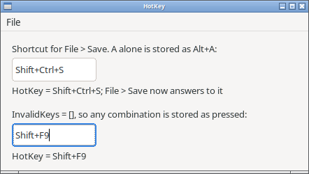

<p align="center">
  
</p>

<h1 align="center">HotKeyBox</h1>

<p align="center"><strong>Delphi's THotKey for Lazarus.</strong><br>
<span>A box where the user presses a key combination, and it shows <code>Shift+Ctrl+F9</code>.</span></p>

<p align="center">
  <a href="LICENSE"></a>
  
  
</p>

**The class, its types, properties and defaults are Delphi's, so a Delphi
form with a `THotKey` on it loads in Lazarus as it is.** The control draws
itself, so it is meant to look and work the same on every widgetset. It is one unit
and needs the LCL alone.



[ROADMAP.md](ROADMAP.md) says what is done and what is not.

## Why

Lazarus has no shortcut entry control on the palette; the only one in the
tree is `TShortCutGrabBox` inside the IDE's own package. The one
re-creation of THotKey on GitHub is GPL-3 and uses the Windows unit.

## Use

1. Install the package (below). `THotKey` appears on the Common Controls
   tab.
2. Drop a `THotKey` on a form.
3. Read `HotKey` in its `OnChange` event. It is a `TShortCut`, the type
   `TMenuItem.ShortCut` and `TAction.ShortCut` take:

```pascal
procedure TForm1.HotKey1Change(Sender: TObject);
begin
  mnuSave.ShortCut := HotKey1.HotKey;
end;
```

With the Delphi defaults (`InvalidKeys = [hcNone, hcShift]`,
`Modifiers = [hkAlt]`) a key pressed alone gets Alt added: `A` is stored as
`Alt+A`, `Ctrl+A` stays `Ctrl+A`. Set `InvalidKeys` to `[]` to store every
combination as pressed. Backspace or Delete clears the box to `None`; Tab,
Enter and Esc go to the form as usual.

`demo/` has a box wired to a menu item and a second box with
`InvalidKeys = []`.

## Delphi forms

The class name, the types `THKModifier`, `THKModifiers`, `THKInvalidKey`
and `THKInvalidKeys`, the property names and the defaults are Delphi's, so
a `.dfm` with a `THotKey` loads without edits. `hkExt`, the Windows
extended-key flag, is accepted and ignored. The box records Shift, Ctrl
and Alt, the modifiers Delphi's `TShortCut` has; the macOS Command key is
left out.

## Current scope

Checked on **Linux with GTK3**: key handling, the `InvalidKeys` and
`Modifiers` rules, streaming a Delphi form and an `.lfm`, drawing, and the
height beside a `TEdit`. The package and demo also compile for Windows.
Qt5, Win32 and Cocoa have not been looked at yet.

## Install

Open `hotkeyboxpkg.lpk` in Lazarus, Compile, then Use > Install. The
package needs the LCL and nothing else. `src/hotkeybox.pas` alone also
works on a project's unit path.

## License

[0BSD](LICENSE). Copyright (c) 2026 Tony Stone.
